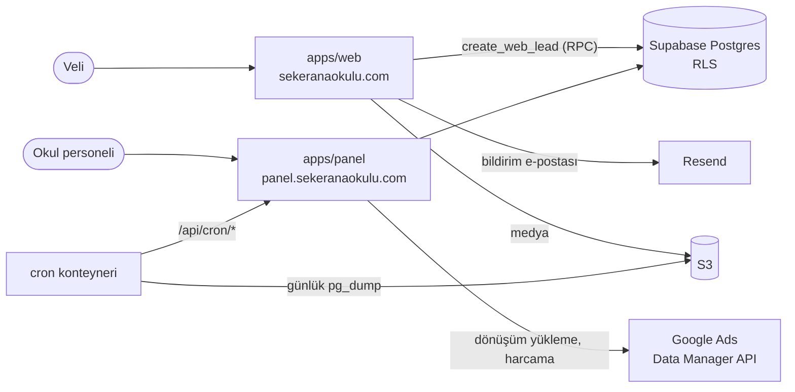

# Şeker Okul Platformu

İstanbul'daki Şeker Anaokulu'nun herkese açık web sitesi ve okul personelinin her gün kullandığı CRM paneli. İkisi tek bir monorepoda duruyor. Bir velinin sitedeki başvurusu panelde aday kartı olarak açılıyor. Aday kayda dönüşürse taksit planı aynı sistemde takip ediliyor. Google Ads'ten gelen aday da kayıt olduğunda dönüşüm reklam hesabına geri yükleniyor.

Tek geliştirici. Uygulama kodu, veritabanı, altyapı ve dağıtım dahil hepsi bu repoda.

## Mimari



| Yol | Ne |
|---|---|
| `apps/web` | Okul sitesi (Next.js 16, React 19). Yaş grupları, aktiviteler, kayıt formu, reklam açılış sayfaları (`/lp/[slug]`), KVKK ve çerez metinleri |
| `apps/panel` | CRM paneli (Next.js 16). Aday pipeline'ı, randevu takvimi, teklifler, öğrenciler, taksit ve ödeme matrisi, gecikenler, pazarlama raporu, geri bildirim kutusu |
| `packages/db` | Supabase şeması, 11 sıralı migration, RLS politikaları, üretilen tipler |
| `packages/auth` | Site ve panelin paylaştığı oturum yönetimi (alan adı genelinde çerez, editör ve admin istemcileri) |
| `packages/shared` | Ortam değişkeni doğrulama, telefon normalleştirme |
| `infra/` | Docker Compose, Caddy, cron, yedekleme, AWS IAM politikaları, kurulum ve geri dönüş dokümanları |

## Öne çıkan parçalar

**Başvurudan kayda tek akış.** Veli formu `create_web_lead` RPC'sine gidiyor. Lead oluşturuluyor, danışmana bildirim ve e-posta gidiyor. Aynı telefon numarasından açık bir başvuru varsa yeni kart açılmıyor. Mevcut karta "tekrar başvurdu" olayı yazılıyor ve bildirim 10 dakika susturuluyor.

**Yetkiyi veritabanı veriyor.** İki rol var: yönetici ve danışman. Erişim kuralları uygulama kodunda değil, Postgres RLS politikalarında. `apps/panel/tests/rls/` altındaki testler bu politikaları her CI koşusunda gerçek bir yerel Supabase'e karşı çalıştırıyor.

**Reklam dönüşümleri geri yükleniyor.** Kayıt olan adayların gclid'leri Google Ads Data Manager API'sine yükleniyor (`apps/panel/lib/ads/`). Yükleme idempotent. Her satırın sonucu ve requestId'si saklanıyor. 89 günden eski tıklamalar ve yalnızca arama izni vermiş veliler yüklenmiyor. Panel, kampanya harcamasını çekip aday başı ve kayıt başı maliyeti gösteriyor.

**Site yerinde düzenleniyor.** Panele giriş yapmış personel siteyi kendi üzerinde düzenleyebiliyor (Next.js draft mode ve `@seker/auth/editor`). Metin ve görsel değiştirmek için deploy gerekmiyor. Yasal metinlerde biçimlendirme kısıtlı. KVKK onay cümlesi düzenlenemiyor.

**Gizlilik varsayılan.** Ziyaret sayacı çerez kullanmıyor (`/api/v`). IP ya da kimlik saklanmıyor, yalnızca gün × sayfa × kaynak × cihaz toplamı tutuluyor. Botlar ve giriş yapmış personel sayılmıyor. Google etiketleri yalnızca onay modu izin verdiğinde yükleniyor.

## Altyapı ve dağıtım

- Tek bir sunucuda Docker Compose: `caddy` (otomatik TLS), `web`, `panel`, `cron`. Her konteynerin bellek sınırı var.
- `ci.yml`: her PR'da ve `main`'e her push'ta yerel Supabase ayağa kalkıyor, ardından `turbo run lint typecheck test` koşuyor.
- `deploy.yml`: CI `main`'de geçerse iki imaj commit SHA'sıyla etiketlenip GHCR'a gönderiliyor, sonra sunucuya dağıtılıyor. Geri dönüş için `infra/rollback.sh` var.
- Yedekleme: her gece `pg_dump` ile `public` ve `auth` şemaları S3'e gidiyor. Şüpheli derecede küçük dökümler hata veriyor. Healthcheck ping'leri kaçan işleri haber veriyor. Geri yükleme adımları `infra/restore.md` dosyasında.

## Testler

Yaklaşık 140 test dosyası var (Vitest). Birim testleri, RLS testleri, ziyaretçi HTML'i için snapshot testleri ve aktarım betiği testleri. Hepsi CI'da koşuyor.

## Yerel çalıştırma

```bash
pnpm install
pnpm db:start   # yerel Supabase (Docker gerekir)
pnpm dev        # web :3000, panel :3001
```

Node 22+ ve pnpm 10 gerekir. Ortam değişkenleri için `apps/web/.env.example` ve `infra/env.example` dosyalarına bakın.

## Dokümanlar

- `docs/superpowers/`: her fazın planı ve spec'i
- `docs/ogretmen-kilavuzu.md`: personel için kullanım kılavuzu
- `docs/pazarlama-kurulum.md`: Google Ads ve GA4 kurulumu
- `infra/server-setup.md`, `infra/cutover.md`: sunucu kurulumu ve eski CRM'den geçiş
